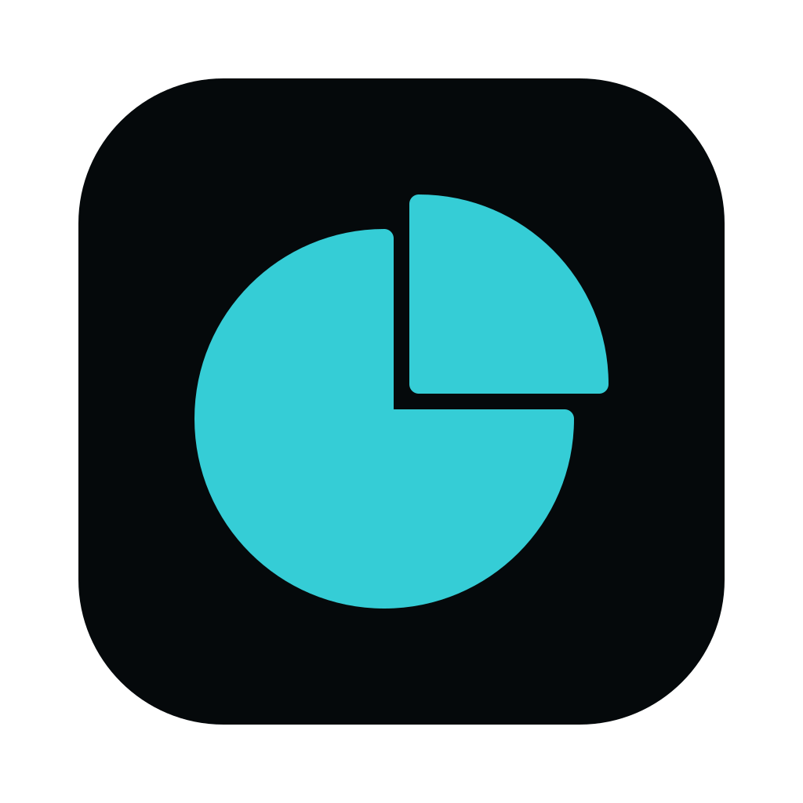
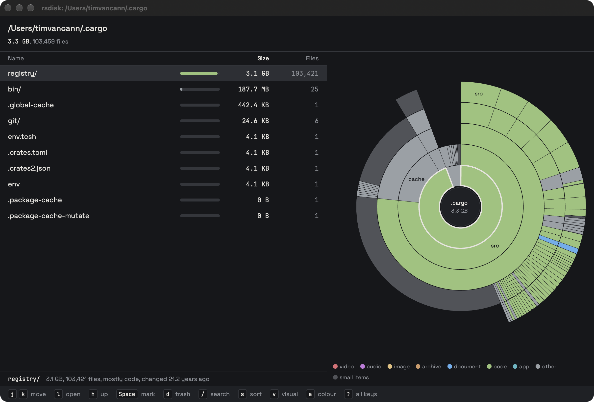
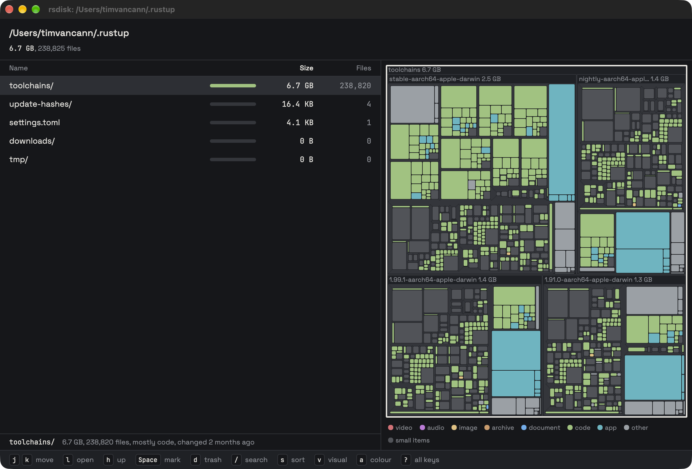

<h1 align="center">
  <br>
  rsdisk
</h1>

<p align="center">
  A fast disk space analyzer and cleaner for macOS.<br>
  See where the space went, mark what you don't need, and move it to the Trash.
</p>

<p align="center">
  <a href="https://github.com/timvancann/rsdisk/actions/workflows/ci.yml"></a>
  <a href="LICENSE"></a>
</p>



When the disk is full I want the space back quickly, not a tour of my files. rsdisk scans
your home folder with [dua](https://github.com/Byron/dua-cli)'s engine, shows the result
as a sorted list beside a treemap or sunburst, and lets you clean up from the keyboard.

- Scans a home folder of 4 million files in about 15 seconds on an M5 Pro, within 6% of
  dua itself ([benchmarks](docs/benchmarks.md)), and shows the biggest folders filling in
  while it runs.
- A sorted list with the visual beside it, always on the same folder. Click a column to
  sort, click a cell to select it, double-click to go in.
- Colour by file kind (video, archives, code, apps...) or by age, to find what's big and
  old at a glance.
- Mark with `Space`, or right-click a row or a cell at any depth, review the total, and
  send it all to the Trash in one go. It goes through Finder, so Put Back works.
- `/` searches the whole scan, so `lib/cach` finds `~/Library/Caches`.
- Vim keys (`j`/`k`, `l`/`h`, `gg`/`G`), with the common ones along the bottom of the
  window and `?` for the rest. Quick Look with `p`, reveal in Finder with `o`.
- Your installed [Zed](https://zed.dev) themes, following the system's light and dark mode.
- No network, no telemetry, nothing saved but your settings.



## Installing

There's no prebuilt download yet. Build it with [Rust](https://rustup.rs),
[just](https://github.com/casey/just) and [resvg](https://github.com/linebender/resvg)
(for the app icon), on macOS 13 or newer:

```sh
just install    # build RSdisk.app into ~/Applications
just run        # or run from source, scanning ~
just run ~/Downloads   # or any folder
```

To see everything, give RSdisk Full Disk Access in System Settings, Privacy & Security.
Without it macOS hides parts of `~/Library`, `~/Desktop`, `~/Documents` and
`~/Downloads`, and rsdisk says so. The first time you trash something, macOS asks whether
RSdisk may control Finder. `⌘,` shows both permissions and links to the right setting.

`bundle.sh` signs the app with a fixed certificate when you have one (set `RSDISK_SIGN`
to its name), so those permissions survive rebuilds. Without one it signs ad hoc, and macOS
asks again after every install.

## How sizes are counted

Sizes are what deleting gives back: allocated blocks, not file lengths. A hardlinked file
counts once. Files cloned on APFS count in full each time, so a folder of clones reads
larger than the space it frees.

rsdisk stays on the volume you scan, and doesn't go into `~/Library/CloudStorage` or
iCloud Drive: walking those can download files. They're listed as "not scanned", `c`
scans one when you ask, and they can't be trashed, since that would delete the files on
every device. Folders macOS won't let it read are listed too (`e`), never skipped quietly.

## Credits

rsdisk stands on these projects:

- [dua](https://github.com/Byron/dua-cli), through its `dua-core` crate, for the walk.
- [GPUI](https://www.gpui.rs), Zed's UI framework, through
  [gpui-pre](https://crates.io/crates/gpui-pre) and
  [gpui-component](https://github.com/longbridge/gpui-component).
- [rayon](https://github.com/rayon-rs/rayon) for parallel work,
  [trash](https://github.com/Byron/trash-rs) for the Trash, and
  [objc2](https://github.com/madsmtm/objc2) for Quick Look.
- Fonts [Space Grotesk](https://fonts.google.com/specimen/Space+Grotesk) and
  [JetBrains Mono](https://www.jetbrains.com/lp/mono/), with their licences in
  `assets/fonts/`.

Mostly written by [Claude Code](https://claude.com/claude-code). Its look follows
[Odeion](https://github.com/timvancann/odeion), a sibling app.

## Licence

[MIT](LICENSE). The bundled fonts keep their own licence (OFL), beside them in
`assets/fonts/`.
